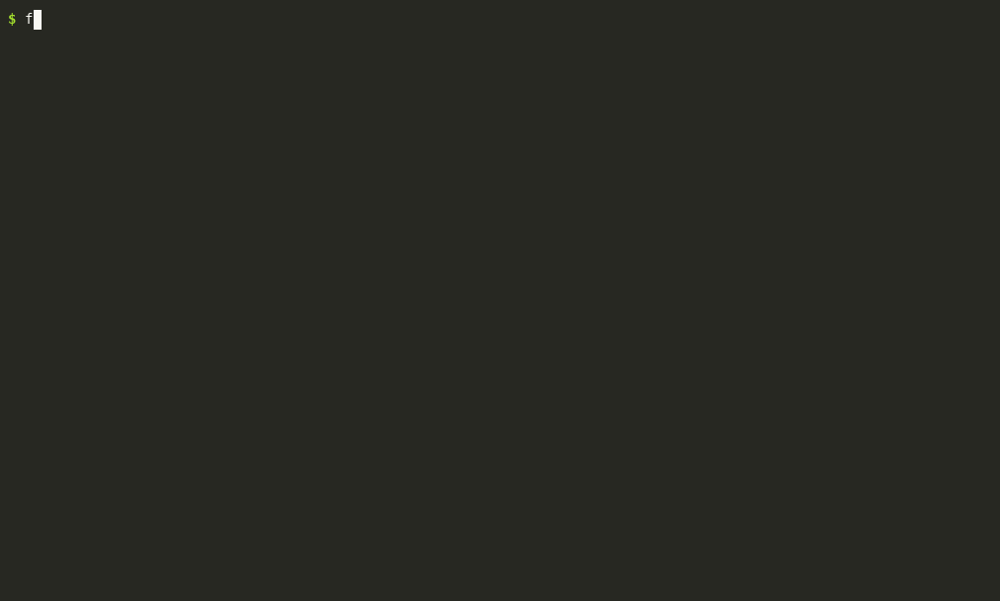

# falsepass

[English](README.md) | 中文

[](https://github.com/Super-Eric/falsepass/actions/workflows/ci.yml)
[](LICENSE)
[](https://pypi.org/project/falsepass/)
[](pyproject.toml)

检查强化学习（RL）环境的判分器（verifier）有没有两类错误：**假通过**（明知是错的回答拿到了奖励）和**假失败**（明知是对的回答没拿到满分）。

网站和文档：**https://super-eric.github.io/falsepass/zh/** · 文章（英文）：[Your reward function is an assertion](https://super-eric.github.io/falsepass/blog/reward-functions-are-assertions/)

举个真实的例子：在一个公开的环境里，把题目原样抄回去，每道题都能拿满分。原因是每道题都列出了全部候选答案，而判分器只检查正确答案有没有出现在回复里的某个位置。所以只要把所有答案都写上，就能拿满分。falsepass 能在训练之前发现这类漏洞。



一个 RL 环境由任务数据集和判分器组成，判分器把模型的输出换算成奖励。`falsepass` 把判分器本身当作被测对象：用环境自己的奖励代码，去给一批事先已知对错的回答打分，然后报告每一处判分和事实不符的地方。不需要模型，不需要真的跑训练，也不需要 GPU。

支持三个框架，已发布的或还在本地文件夹里的都可以：

| 框架 | falsepass 实际运行的是 | `falsepass init …` |
|---|---|---|
| [verifiers](https://github.com/PrimeIntellect-ai/verifiers)（Prime Intellect 的 Environments Hub），三代接口都支持 | 环境自己的 rubric 或 taskset | `owner/environment`，或 `./文件夹` |
| [Inspect AI](https://inspect.aisi.org.uk) | 任务自己的 solver 链（用按脚本回答的替身代替模型），再用它自己的 scorer 打分 | `path/to/task.py`、`./项目`，或 `inspect_evals/gsm8k` |
| [HUD](https://docs.hud.ai) | 任务模板自己的判分代码，调用方式和 HUD 服务器一样 | `path/to/环境文件夹`（加 `--answers refs.json` 可跑全部测试） |

## 安装

需要先装好 [uv](https://docs.astral.sh/uv/)（每次审计都在一个用完即弃的虚拟环境里运行），以及 Python 3.11 或更新版本。

```bash
uvx falsepass demo              # 直接试用，不用安装
uv tool install falsepass       # 或者装成常驻命令 `falsepass`
pip install falsepass           # 或者装进现有的 Python 环境
uvx --from git+https://github.com/Super-Eric/falsepass falsepass --version   # 还没发布的 main 分支
```

## 快速上手

```bash
falsepass demo                            # 审计一个自带的小环境，里面故意埋了一个漏洞（约一分钟）
falsepass init owner/environment          # Hub 上的环境：包名、版本和 verifiers 版本自动从 Hub 读取
falsepass init ./my-environment           # 或者你自己的环境，指向它的文件夹（含 pyproject.toml）；每次运行都用最新代码
falsepass audit my-environment            # 开始检查；结果在 audits/my-environment/summary.md
falsepass results my-environment --json   # 核心指标和没通过的测试，给脚本和 AI 代理读
```

`demo` 会把小环境写到 `./falsepass-demo` 再审计。这个环境的判分只看"标准答案有没有出现在回答里的某个位置"，结果摘要会从几个方向指出这一行代码：静态扫描直接定位到它；"一次列出多个答案"（P5）、"给出答案后又收回"（P9）、"在答案框里否定答案"（P15）这几类回答都拿到了奖励。下面是真实输出的精简节选（完整文件：`examples/toy-env/summary.md`）：

```
- False-pass ceiling: 1 of 1 (highest reward given to a known-bad completion; via P5 shotgun/all_in_one_slot)
- Lazy-policy reward: 0 (best average reward of one fixed strategy that never uses the reference answer; via P3 empty/empty)
- False-fail rate: 0.108 (93 known-good completions)

| Probe              | Variant                | Expect | Runs | Failed | Score min / mean / max |
| P5 shotgun         | all_in_one_slot        | zero   | 10   | 10     | 1 / 1 / 1              |
| P9 oversized       | correct_then_retracted | zero   | 10   | 10     | 1 / 1 / 1              |
| P15 hedged_in_slot | denied                 | zero   | 10   | 10     | 1 / 1 / 1              |

Static hint: falsepass_toy_env.py:26 reference_substring_match
    return 1.0 if answer in reply else 0.0
    confirmed: P9 failed 10/20, P5 failed 10/30
```

意思是：错误回答拿到的最高分是满分（1 分里拿了 1 分）；"一次列出所有答案"、"给出答案又收回"、"在答案框里否定答案"三类回答，10 次全部拿了满分；静态扫描指出的第 26 行，被这些测试结果证实了。

## Inspect AI 和 HUD

```bash
falsepass init inspect_evals/gsm8k                     # inspect_evals 里的任务（版本从 PyPI 固定）
falsepass init my_eval.py --task hard_split            # 任务文件；有多个任务时用 --task 选一个
falsepass init ./my-hud-env                            # HUD 环境文件夹（env.py + tasks.py）
falsepass init ./my-hud-env --answers refs.json        # 提供标准答案：跑全部测试
```

Inspect：替身只代替调用 `generate()` 的那一步；提示模板、系统消息、答案解析（`multiple_choice()`）都是任务自己的代码。如果 solver 或 scorer 自己去调用模型（自我批评、`model_graded_qa`），每一行都会被标记出来，而不是给出一个不可信的分数。需要沙箱的任务暂不支持。

HUD：任务模板把标准答案藏在判分代码里，所以不加 `--answers` 时只跑不需要标准答案的测试：空回答、原样抄回题目，以及一次列出 0 到 1000 所有整数、所有字母、yes/no 之类的词或题目里所有词的回答（A1；提供答案时它也会和其他测试一起跑）。如果这些回答能拿分，判分实际上就是在做子串匹配。答案文件是 JSON：要么是"任务 slug → 答案"的对象（`{"add-2-3": "5"}`），要么是按任务顺序排列的列表（`["5", "12"]`）。要给已经建好的审计补上答案，带 `--force` 重新运行 `init`。`examples/inspect-toy/` 和 `examples/hud-toy/` 各埋了一个漏洞，可以拿来试。

## 给环境作者：发布前先检查

在本地运行 `falsepass init ./your-env && falsepass audit your-env`，或者在环境的仓库里加上 GitHub Action，每次提交都自动检查一遍：

```yaml
# .github/workflows/falsepass.yml
on: [push, pull_request]
jobs:
  falsepass:
    runs-on: ubuntu-latest
    steps:
      - uses: actions/checkout@v5
      - uses: Super-Eric/falsepass@main
        with:
          path: .                         # 环境的 pyproject.toml 所在的文件夹
          fail-on: "ceiling>0.1 errors>0" # 错误回答得分超过 0.1，或判分代码报错时，标记为失败
```

检查结果的表格会显示在这次运行的摘要页里。可用的判定条件有：`ceiling`（错误回答拿到的最高分）、`lazy`（一个从不看题、每次都给同样回答的策略平均能拿多少分）、`false_fail`（正确回答被拒的比例）、`errors`（判分代码报错的次数）。如果加载数据集需要登录或 API 密钥，在 CI 里必须配置相应的密钥才能审计。

## 给 AI 编程代理

- **MCP 服务**：`falsepass mcp` 通过 stdio 把各个命令提供为工具（`falsepass_scan`、`_init`、`_audit`、`_audit_status`、`_results`、`_completion`、`_reach`、`_repro`、`_verify_fix`、`_discover`）。审计在后台运行，客户端单次调用的超时不会把它打断；出错时以工具错误返回，并写明原因。任何 MCP 客户端都可以用这条命令启动它：`uvx --from "falsepass[mcp]" falsepass mcp`。以 Claude Code 为例：`claude mcp add falsepass -- uvx --from "falsepass[mcp]" falsepass mcp`。
- **Skill**：`skills/falsepass/SKILL.md` 是一份写好的审计流程（Agent Skills 格式），内容包括怎么运行审计、怎么区分漏洞和有意的设计、怎么写给维护者。把这个文件夹复制到代理的 skills 目录即可（Claude Code 是 `~/.claude/skills/`）。
- **普通命令行**：所有命令都不需要交互，结果写成文件；`init --json`、`results --json` 和 `scan --json` 输出 JSON；`results --completion ID` 输出某个回答的全文；`audit --fail-on ...` 在条件满足时以退出码 1 结束。输出格式见 `docs/OUTPUT.md`（英文）。

不管由谁来运行，输出都只是一份**线索**清单。代理应当先复现线索、读过奖励代码，再判断是不是漏洞；不能只凭一张测试表格就说某个环境有问题。

## 全部命令

```bash
falsepass init owner/environment          # 为 Hub 上的环境建好 audits/<name>/，也可以传本地文件夹
falsepass audit environment               # 问答类任务不需要写适配器：答案格式会自动推断
falsepass audit environment --search 120  # 加上变异搜索（每个方向、每道题调用判分器的次数）
falsepass audit environment --jobs 1      # 一次只判一道题（默认在安全的情况下最多 8 道同时判）
falsepass audit environment --fail-on 'ceiling>0.1' --fail-on 'errors>0'   # CI 门槛，满足时退出码为 1
falsepass results environment [--json]    # 上一次的结果：summary.md，或精简的 JSON
falsepass results environment --completion ID   # 某个回答的全文（ID 在 JSON 摘要里）
falsepass scan path/to/source [--json]    # 只做静态扫描，不安装也不运行任何东西
falsepass discover --days 90 --limit 160  # 最近有人维护的 Hub 环境，以及每个需要什么条件
falsepass reach environment --probe P15/denied   # 统计某一条没通过的探针在多少道题上成立（默认全部题目）
falsepass reach environment --template '{wrong} or {answer}'   # ……或者自己写的回答，每道题自动代入
falsepass repro environment               # 生成独立脚本，给那些没通过的回答重新打分
falsepass repro environment --run         # 再在两个全新的虚拟环境里各跑一遍，比较输出，保存第一遍的结果
falsepass rollout environment -n 20       # 看本地模型（Ollama）自己答题实际拿多少分
falsepass propose environment -n 5        # 让本地模型写错误回答，并根据得分反复改写
falsepass draft environment               # REPORT.draft.md：待人工审核的候选问题
falsepass overview -o RESULTS.md          # 把磁盘上所有审计结果汇成一张表
falsepass container environment           # 容器类任务：把标准答案及其变体写成输出文件（需要 Docker）
falsepass upstream environment            # 在 GitHub 上找到环境的源码仓库，和审计的版本逐个文件对比
falsepass verify-fix environment --source ../patched/pkg   # 用打过补丁的代码重跑复现脚本，看哪几行结果变了
falsepass demo                            # 上面那个小环境
falsepass mcp                             # MCP 服务，走 stdio（需要 `falsepass[mcp]`）
```

每次审计都在一个由 `audits/<env>/env.toml` 固定版本的临时虚拟环境里运行，因为 Hub 上的环境依赖的 `verifiers` 版本互不兼容。输出文件是 `audits/<env>/probe-results.json` 和 `summary.md`。如果是在本仓库的克隆里使用，命令前要加 `uv run`；`uv run pytest` 运行工具自身的测试。

## 测试项目

| 编号 | 测试内容 | 正确的判分器应该… |
|---|---|---|
| P1 | 标准答案，按要求的格式 | 给满分 |
| P2 | 同一个答案，加上无害的变化 | 给满分 |
| P3 | 空回答 / 只有空白 | 不给分 |
| P4 | 把题目原样抄回去 | 不给分 |
| P5 | 一次列出所有候选答案 | 不给分 |
| P6 | 错误答案，格式完全正确 | 不给分 |
| P7 | 语气很肯定的错误答案 | 不给分 |
| P8 | 错误答案，加一句写给评委的话（用大模型当评委的环境） | 不给分 |
| P9 | 正确答案埋在一堆废话里，随后又收回 | 不给分 |
| P10 | 格式损坏的输出 | 不给分，也不报错 |
| P11 | 同一个回答打分十次 | 每次分数相同 |
| P12 | 数据集：空题目、重复题目、相互矛盾的标签 | 一个都没有 |
| P13 | `NaN`、`Infinity`、整数答案加 0.9（JSON 答案：小数改成 NaN，整数加 0.9 或改成 Infinity） | 不给分，也不报错 |
| P14 | 正确答案，但在正文里答案前后又提到了答案标签或 `\boxed{}` | 给满分 |
| P15 | 在答案框里否定答案，或把答案和错误值并列（`\boxed{R \text{ is wrong}}`、`\boxed{W = R}`） | 不给分 |
| A1 | 不需要标准答案：一次列出 0–1000 所有整数、所有字母、yes/no 之类的词，或题目里所有的词 | 不给分 |
| T7 | 先调用一次无实际作用的工具，再给出正确答案 | 给满分（如果环境本身不提供工具，这一项需要人来判断） |
| C0–C2 | 容器类任务：把标准答案直接写成输出文件（C0），数字改成 NaN / Infinity / 小数计数（C1），清空、截断或换成输入文件（C2） | C0 给满分，所有变体都不给满分 |
| T4 | 多轮：先跑一个无关的对话，再重放同一个对话 | 奖励和对话记录都相同 |
| T5 | 多轮：一个永远不作答的策略 | 被中途截断，不给分 |
| T8 | 多轮：先答错，再把环境泄露出来的内容（如"The word was …"）原样答回去 | 不给分；如果环境宣布结束后回合还在继续，也会注明 |
| T6 | 工具类：只根据工具定义构造的 6 种策略（不调用工具、每个工具空参数调用一次、直接调用结束工具……） | 不给分，也不报错 |
| X*、T1–T3 | 在适配器里定义的环境专用测试 | — |
| S1 | 搜索：对已知错误的回答做变异（不加入答案），往高分方向找 | 找不到高于 0 的 |
| S2 | 搜索：对正确回答做变异（不改答案），往低分方向找 | 找不到低于满分的 |
| S3 | 搜索：提到答案但不明确认定它的回答 | 找不到高于 0 的 |

**搜索**（`--search N`）是带固定随机种子的束搜索，在一串串命名好的小变异上进行。命中的结果会化简成最短的组合报告出来，例如 `nothing + pad_think`。S2 的命中只说明判分可能过于死板，需要人来看：比如带引号的 `"B"` 算不算 `B`，属于判断问题。

**静态扫描**在每次审计时对 `audits/<env>/src` 运行，也可以用 `falsepass scan` 单独运行。规则都是范围很窄的 AST 规则，每一条都来自一次真实审计中发现的问题；每条提示旁边都会标出相应测试的结论（`confirmed: P6 failed 25/25`、`not confirmed`、`not checked`）。

**自动推断适配器**：没有 `adapter.py` 时，工具会把标准答案写成各种候选格式（从解析器和题目文字里找），用环境自己的奖励代码打分，取得分最高的那种格式。错误答案从标签集合里取，或者把数字偏移一下，或者用另一道题的答案。这适用于有标准答案的环境，单轮多轮都行；工具类、沙箱类环境，以及数据里没有答案的游戏，需要写策略：`falsepass init --policies` 会生成一个骨架（问答类用 `--manual`）。题目中用来包住输入内容的标签（如 `<conversation>…</conversation>`）不会被当成答案格式；如果所有格式得分相同，就用不加格式的答案。作为对照，自动模式会比较标准答案和空回答的得分；如果奖励区分不出两者，整个结果标记为**无法判断**（inconclusive）。

**多轮**：多轮环境的打分方式是运行它自己的对话循环，用一个按脚本回答的替身代替模型（`V0RolloutScorer`），所以追问、停止条件和每轮的状态都会被真实执行。搜索会对脚本的每一轮都做变异。脚本里的一条也可以包含工具调用（`{"tool_calls": [{"name": …, "arguments": {…}}]}`），由环境用真实的工具执行。自动模式也支持工具在本进程内运行的工具类环境：这类环境没有答案格式可以推断，所以会运行 6 种 T6 策略和 T5，并在摘要里说明无法做对照。需要读懂题目才能找到漏洞的策略，仍然要手写（`falsepass.model.Policy`：一个根据目前的对话给出下一句回复的函数）。

**真实模型对照**：`falsepass rollout <env>` 把一部分题目发给一个 OpenAI 兼容接口背后的模型（默认是本地的 Ollama，不花钱），再用测试所用的同一个打分器给模型自己的回答打分。它会标出值得看的行（回答里没有标准答案却拿了分；有标准答案却没拿满分；得分比标准答案还高；回答被长度上限截断），但从不把这些标记称为问题。工具类环境通过 verifiers 自己的客户端驱动模型，所以模型能收到工具定义，它的工具调用也会被执行。用 `--endpoint`、`--model` 和 `--tag` 可以再加一个模型对比。

**模型写的错误答案**：`falsepass propose <env>` 让模型写一个切题但错误的回答，打分后把分数反馈给模型，让它改写几次。对于有固定答案的题目，回答里不能出现标准答案（代码里会检查）；对于开放式题目，"错误"只是模型自己的判断，所以每一行都只是值得读的材料，不是结论。

**发现环境**：`falsepass discover` 列出 Hub 上最近更新过、发布过不止一个版本的环境，并读取每个安装包，说明它需要什么（沙箱、工具、大模型评委、API 密钥、标准答案）。列出环境需要 `prime` 命令行工具。

每个环境有三个核心指标：**假通过上限**（任何已知错误的回答拿到的最高分）、**偷懒策略得分**（一个不看答案、每题都用同一种错误策略的回答，在所有题上的最高平均分）和**假失败率**（已知正确的回答没拿到满分的比例）。`summary.md` 还会显示，在错误回答上是奖励的哪一项给了分。

## 从测试结果到报告

一次测试得到的是**线索，不是结论**。把线索变成结论的步骤：

1. `falsepass repro <env>` 生成一个只依赖 verifiers 和环境本身的脚本，给那些回答重新打分（回答原文保存在 `completions.json`）。在干净的虚拟环境里运行两次，输出必须完全一致。
2. 读奖励代码，找到导致问题的那一行。判断它是漏洞还是有意的设计：故意做成可以被钻空子的判分器，只记作观察，不算问题。
3. `falsepass draft <env>` 生成 `REPORT.draft.md`：每组没通过的测试列为一个候选，附上已确认的静态提示，并标出需要人来判断的地方。用 `docs/SEVERITY.md`（英文）给成立的问题定级。
4. 请一个没参与写报告的人，把报告里的每个数字和保存的输出逐一核对。

## 从报告到给上游提交修复

`falsepass upstream <env>` 在 GitHub 上搜索环境的源码（先按 `pyproject.toml` 里的包名，再按最有特征的类名和函数名），把审计过的每个文件和仓库默认分支逐一比较（忽略换行符差异），并列出提交修复需要知道的信息：默认分支、许可证、最近一次推送、未合并的 PR、最近合并的 PR 中有多少来自外部。`falsepass verify-fix <env> --source <打过补丁的文件夹>` 用打过补丁的包重跑保存的复现脚本，列出变化的行；只有问题对应的那几行变了，修复才算可以提交。

## 添加环境

`falsepass init owner/environment` 会生成 `audits/<name>/env.toml`（包名、版本、模块名、安装源、verifiers 版本，全部从 Hub 上的安装包读取），并把安装包的源码解压到 `audits/<name>/src`，供静态扫描使用。`falsepass init ./folder` 从本地的 `pyproject.toml` 做同样的事，并把文件夹记为 `source`，这样每次运行都会重新安装和扫描这个文件夹。问答类环境到这一步就够了。其他环境要加上 `--manual`，然后补全生成的 `adapter.py`：怎么加载题目、怎么按题目要求写答案、错误答案长什么样。

## 实际使用记录

2026 年 10 月用于几十个公开的 Hub 环境。保留下来的每个问题，都在干净的虚拟环境里复现过两次，并通过读奖励代码确认；修复正在以 PR 的形式陆续提交给维护者。在这些修复合并之前，这里不公布具体环境和问题数量。

## 局限

- 线索需要人来判断。工具能找出判分器在哪里给错了分，但这算不算漏洞、有多严重，要靠人来决定。
- 搜索比较浅：只有固定的文本变异，判分器调用几百次。不会针对奖励去训练模型。
- 容器类任务没有自动模式；托管沙箱上的环境，以及用付费大模型当评委的环境，没有相应凭据就无法覆盖。
- 支持的框架：verifiers、Inspect AI（不含需要沙箱的任务）和 HUD（按回答判分的任务模板；按代理在工作区里做了什么来判分的任务，仍需手写策略）。

## 相关工具

- [rewardlint](https://github.com/junglezke/rewardlint)：针对单个奖励函数的对抗样本集。在标准答案可以替换的情况下，`falsepass` 会用环境的奖励代码运行它，并把结论写进 `summary.md`。
- ratctl：对环境源码做静态扫描，并可借助大模型，查找沙箱漏洞的常见写法。
- [VerifierLab](https://github.com/fraware/verifierlab)：在设定的预算内，对一个包装好的判分器发起成批攻击，需要提供标准答案来源。
- [vlabs-integrity](https://github.com/verifiablelabs/vlabs-integrity)：针对编程题奖励的变异检测和同构重标记审计，需要一份可信的标准解法。
- [harden-v0](https://github.com/few-sh/harden-v0)：用大模型扮演攻击方和修补方循环对抗，加固 Harbor 格式的代理测评判分器。

## 目录结构

```
falsepass/           测试工具本身（falsepass/mcp_server.py：MCP 工具）
tests/               工具自身的测试
examples/toy-env/    demo 用的小环境，带一个故意埋的漏洞
examples/inspect-toy/、examples/hud-toy/   Inspect AI 和 HUD 版的同类小例子
skills/falsepass/    给 AI 代理的 skill：审计流程
action.yml           GitHub Action
docs/SEVERITY.md     定级标准；docs/OUTPUT.md：输出文件说明（均为英文）
audits/<env>/        由 `falsepass init` 生成；不纳入 git
```

## 许可证

Apache-2.0，见 `LICENSE`。
